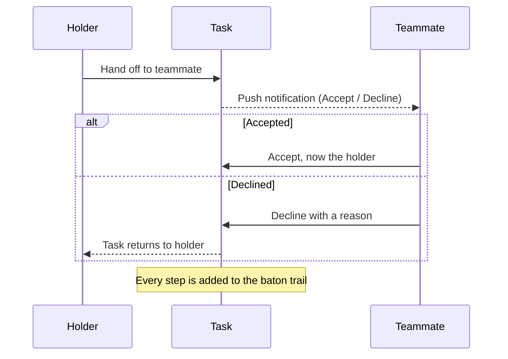
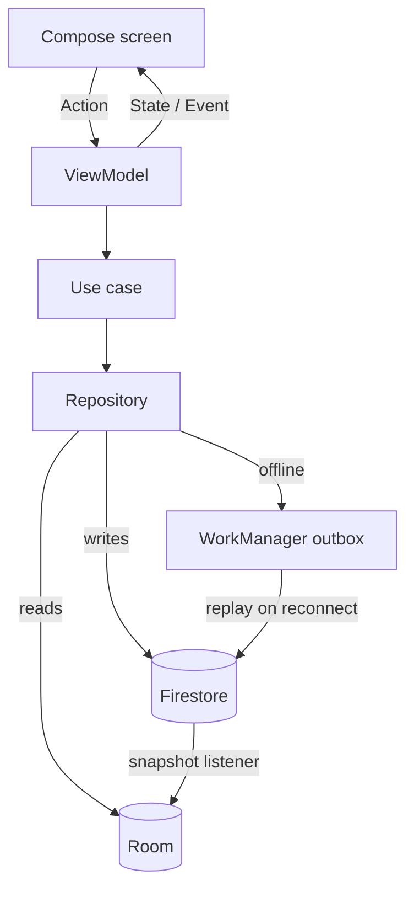

<div align="center">

# Temacker

**Pass work along without losing track of it.**

An offline-first Android app for small teams, built on a simple rule: every task has exactly one holder.


</div>

---

## Table of contents

- [Why Temacker](#why-temacker)
- [How it works](#how-it-works)
- [Features](#features)
- [Tech stack](#tech-stack)
- [Architecture](#architecture)
- [Engineering highlights](#engineering-highlights)
- [Getting started](#getting-started)
- [Testing](#testing)
- [Project structure](#project-structure)
- [Status and roadmap](#status-and-roadmap)
- [Author](#author)

## Why Temacker

In most task trackers, "assigned to" is just a label. Work gets reassigned without anyone agreeing to take it, and nobody can say where a task got stuck.

Temacker treats a task like a relay baton. One person holds it at a time. To pass it on, the holder **hands it off**, and the other person must **accept** it or **decline with a reason**. Every step is recorded in the task's **baton trail**, so it's always clear who owns what and where work is waiting.

## How it works



A task's status comes from its holder history: **To do** until the first accepted handoff, then **Doing**, then **Done**.

## Features

| Feature | What it does |
|---|---|
| **Projects and invites** | Create a project, or join one with a time-limited invite code. Swipe between projects from any tab. |
| **Roles and permissions** | Custom roles with fine-grained permissions. The Leader role is fixed, and leadership can be transferred. |
| **Board and baton** | Hand off, accept, or decline with a reason. Ask to drop or transfer a task. Import tasks from JSON. |
| **Inbox and push** | An inbox of handoffs waiting on you. Lock-screen notifications with Accept and Decline buttons, and a nudge after 18 hours. |
| **Team insights** | **Load** (who holds the most), **Stuck** (handoffs waiting too long) and **Pulse** (recent activity). |
| **Succession** | At the end of a cycle, the Leader archives the project and starts a new one with the same roster and roles. |
| **Works offline** | Changes made offline are queued and sent when you reconnect, with Retry and Discard if something conflicts. |
| **Your data** | Export to JSON or CSV, and delete your account yourself. |

## Tech stack

| Layer | Tools |
|---|---|
| UI | Kotlin, Jetpack Compose, Material 3, Navigation-Compose (type-safe routes) |
| Architecture | Clean Architecture, MVI inside MVVM, use cases, Koin |
| Local data | Room (single source of truth), DataStore, WorkManager |
| Backend | Firebase Auth (Google via Credential Manager, email), Cloud Firestore, Cloud Messaging, Cloud Functions (TypeScript), Hosting |
| Quality | JUnit 5, Turbine, AssertK, MockK, Jest with the Firestore emulator, Crashlytics |

## Architecture

A single `:app` module, organised by feature and then by layer. Dependencies point inward: the domain layer is pure Kotlin with no Android or Firebase imports.



- **Room is the source of truth.** Firestore listeners sync into Room, and the UI only ever reads Room.
- **Errors are typed.** Failures come back as `Result<T, DataError>`, never as thrown exceptions.
- **Features stay separate.** They talk only through contracts in `core/domain`.
- **Every screen is previewable.** Each screen splits into a Root (wired to the ViewModel) and a stateless Screen.

The full design is in [`specs/ultimate_android_architecture.md`](specs/ultimate_android_architecture.md).

## Engineering highlights

- **Offline outbox.** Writes made without a connection go into a Room table. A WorkManager worker replays them in order when the network returns and surfaces conflicts, for example a task someone else already took.
- **Server-side security.** Firestore security rules enforce every permission, covered by 133 emulator tests. Those tests caught a privilege-escalation path that let a joining member make themselves Leader.
- **Real-time sync without stale rows.** Each snapshot removes local rows that are gone on the server, so deleted data never reappears.
- **Safe schema changes.** The Room database moved through 9 schema versions with exported schemas and auto-migrations, with no destructive fallback.
- **Cloud Functions.** TypeScript functions send handoff notifications, clean up after removed members, and nudge handoffs that have waited too long.

## Getting started

### Prerequisites

- Android Studio (recent stable) and JDK 17+
- Node.js 22 and the [Firebase CLI](https://firebase.google.com/docs/cli)
- A Firebase project

### Setup

1. **Clone the repository**
   ```bash
   git clone https://github.com/mahakaal2005/Temacker.git
   cd Temacker
   ```
2. **Connect Firebase.** Add an Android app with the package `com.temacker.app` to your Firebase project, and put its `google-services.json` in `app/`. This file is gitignored.
3. **Register your debug SHA-1** in Firebase so Google Sign-In works:
   ```bash
   ./gradlew signingReport
   ```
4. **Enable services:** Authentication (Google and Email/Password), Firestore, Cloud Messaging and Functions.
5. **Deploy the backend**
   ```bash
   firebase deploy --only firestore:rules,firestore:indexes,functions
   ```
6. **Build and run**
   ```bash
   ./gradlew installDebug
   ```

> **Release builds** read signing details from a `keystore.properties` file at the repository root. It is gitignored and never committed.

## Testing

| Suite | Tests | Command |
|---|---|---|
| Android unit tests (ViewModels, use cases, repositories) | 88 | `./gradlew testDebugUnitTest` |
| Firestore security rules (emulator) | 133 | `npm install && npm run test:rules` |
| Cloud Functions | 17 | `cd functions && npm install && npm test` |

Run lint with `./gradlew lintDebug`. Every screen also has `@Preview`s for its loading, empty, error and populated states.

## Project structure

```
temacker/
├── app/src/main/java/com/example/temacker/
│   ├── core/              Result/DataError, database, FCM, outbox, design system, shared contracts
│   ├── feature_auth/      splash and sign-in
│   ├── feature_project/   projects, roles, members, invites, team insights, succession
│   ├── feature_tasks/     board, handoffs, inbox, offline queue, JSON import
│   └── feature_profile/   profile, data export, account deletion
├── functions/             Cloud Functions (TypeScript)
├── firestore-tests/       security-rules tests
├── hosting/public/        privacy policy and account-deletion pages
├── firestore.rules        security rules
├── firestore.indexes.json composite indexes
└── specs/                 architecture, phase plans, UI concepts, dev logs
```

## Status and roadmap

Temacker is in **closed testing on Google Play** (submitted October 2026) and isn't publicly available yet.

Planned next:

- [ ] Public release on Google Play
- [ ] Compose UI tests and continuous integration
- [ ] Move invite codes under their project for tighter rules
- [ ] Enforce plan limits on the server

Phase plans and current progress are in [`specs/office/`](specs/office/), starting with [`progress.md`](specs/office/progress.md).

## Author

**Atul Kumar Singh**: [GitHub @mahakaal2005](https://github.com/mahakaal2005) · [LinkedIn](https://linkedin.com/in/atulkumarsingh5002) · [atul08.in](https://atul08.in)
